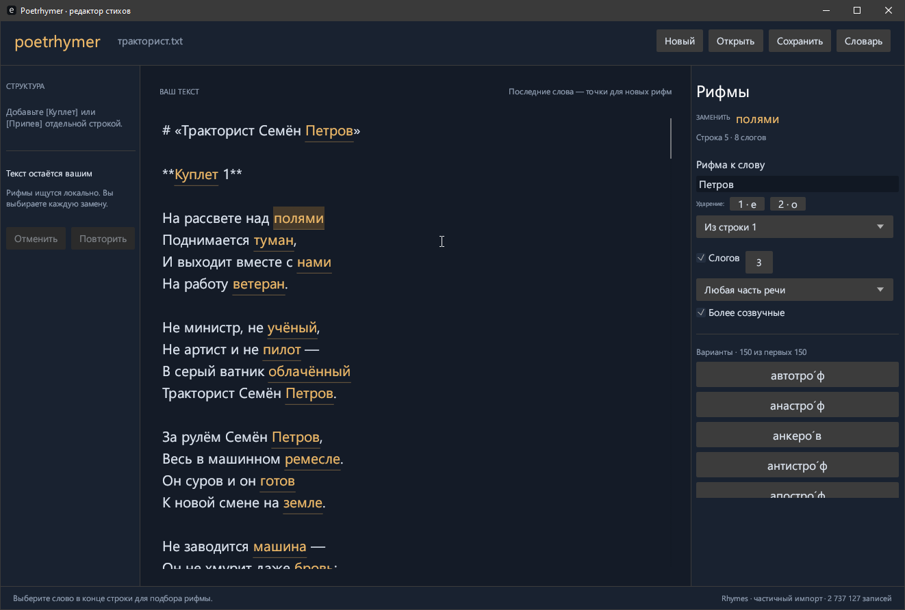

# Poetrhymer

Редактор русских стихов и песен с подбором рифм. Пишите, ищите созвучия и выбирайте каждую замену сами — текст и словарь остаются на вашем компьютере.

**[Скачать для Windows](https://github.com/SargeMadovsky/poetrhymer/releases/latest)** · Windows x64 · v0.1.1

[](assets/readme/poetrhymer.png)

## Что умеет

- Подбирать рифмы к последнему слову строки или к слову из другой строки.
- Уточнять варианты по числу слогов, части речи, созвучию и ударению.
- Разбивать текст на секции: `[Куплет]`, `[Припев]` или ваши названия.
- Показывать замену перед применением, отменять правки и восстанавливать текст после закрытия.

## Как начать

1. Скачайте установщик или portable-файл `Poetrhymer.exe` и запустите его. Установщик не требует прав администратора.
2. Нажмите **«Словарь»** и выберите папку вашей копии [Rhymes 3](https://rifmovnik.ru/).
3. Откройте текстовый файл или напишите несколько строк. Нажмите на подсвеченное слово в конце строки и выберите подходящую рифму справа.

**Словарь не входит в комплект.** Для подбора рифм нужен файл `rus_rhymes.dic` из Rhymes 3. Он читается без изменений; папка `Rhymes 3` рядом с приложением находится автоматически. Проект не связан с разработчиками Rhymes и не распространяет их данные.

`Ctrl+O` — открыть · `Ctrl+S` — сохранить · `Ctrl+Z` — отменить · `Ctrl+Y` — повторить.

## Что важно знать

- **Импорт словаря пока частичный**, оценка созвучия упрощена. Частотной сортировки и определения стихотворного размера пока нет.
- Текст сохраняется в UTF-8, предыдущая версия файла — в `.bak`. Данные приложения, включая portable-версию, хранятся в пользовательской папке; восстановление текста — в `%LOCALAPPDATA%/Poetrhymer/data/recovery.json`.
- Поиск рифм работает локально. При запуске редактор проверяет обновления на GitHub и устанавливает их только по нажатию **«Скачать и установить»**. Подпись пакета проверяется автоматически.
- У приложения пока нет Authenticode-подписи: Windows может показывать неизвестного издателя.

## Сборка из исходников

Нужны Rust stable и Windows C++ Build Tools.

```powershell
cargo test --locked
cargo build --release --locked --bin poetrhymer
```

Готовый файл: `target/release/poetrhymer.exe`. Обычные тесты не требуют словаря.

[Подготовка выпуска и проверка подписей](release/README.md) · [План развития](docs/PLAN.md) · [Источники данных](docs/DATA_SOURCES.md)

Код распространяется по лицензии [MIT](LICENSE). Она не распространяется на сторонние словари; зависимости сохраняют свои лицензии.
